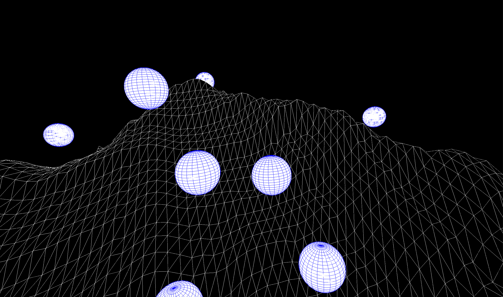

# Fizik : moteur physique en C++ avec visualisation 3D Qt/OpenGL

Projet de programmation (cours ICC / Programmation, section Physique, **EPFL, printemps 2022**),
réalisé à parts égales par **Alexandre Nozet** ([@AlexandreNozet](https://github.com/AlexandreNozet))
et **Adrian Cozma** ([@adricozma](https://github.com/adricozma)).

Le code a été écrit entièrement à la main en 2022, avant l'arrivée des assistants de code IA.
Les seuls changements apportés pour cette publication concernent la compilation (voir
[Notes de portage](#notes-de-portage)).

<!-- CAPTURE D'ÉCRAN : remplacer la ligne ci-dessous par l'image de la simulation de l'Everest -->
<!--  -->

---

## Contenu

Un moteur physique qui intègre numériquement les équations du mouvement d'objets en interaction :

- **Objets mobiles** : `Balle`, `Caillou`, `Boulet`, `Pendule`, `PenduleSpherique`, `Ressort`
- **Obstacles** et gestion des chocs : `PlanInfini`, `PlanFini`, `Brique`, `Sphere`, `Terrain`
- **Champs de forces** : `ChampForces` (gravité), `Vent`
- **Objets composés** : `Ventilateur`
- **Intégrateurs** : Euler-Cromer, Runge-Kutta
- **Terrains réels** : modèles d'altitude projetés de l'Everest, du K2, du Cervin et du Grand Canyon (`height_data/`)
- **Deux rendus** pour les mêmes classes (via `Dessinable` / `SupportADessin`) :
  - mode **texte** : affichage dans le terminal ou écriture dans un fichier pour gnuplot,
  - mode **3D** : Qt 5 + OpenGL, avec caméra libre.

La conception détaillée se trouve dans [`CONCEPTION.pdf`](CONCEPTION.pdf), et le suivi du travail dans
[`JOURNAL.txt`](JOURNAL.txt) et [`REPONSES.txt`](REPONSES.txt). Le mode d'emploi d'origine est
[`README.txt`](README.txt).

```
Projet_Final/
├── general/      classes indépendantes du rendu (physique) + fichiers de test
├── text/         simulation textuelle (main_text.cc)
├── Qt_GL/        simulation 3D Qt/OpenGL (main_qt_gl.cc, vue_opengl.cc, shaders)
└── height_data/  données d'altitude des terrains + Projection.cc
```

## Commandes (simulation 3D)

| Touche / action | Effet |
|---|---|
| Souris, flèches | orienter la caméra |
| `W` `A` `S` `D` | avancer / gauche / reculer / droite |
| `R` `F` | monter / descendre |
| `Q` `E` | rotation autour de l'axe de visée |
| `O` / `Home` | réinitialiser la caméra |
| Espace | pause |

Le choix de la scène se fait en commentant ou décommentant les blocs de `Qt_GL/main_qt_gl.cc`
(la simulation texte se configure de la même façon dans `text/main_text.cc`). Il faut recompiler après chaque changement.
Par exemple, pour l'**Everest**, décommenter le bloc `Terrain EV(...)` et commenter `Terrain K2(...)`.
Une fois la simulation d'un terrain lancée, mettre en pause puis se déplacer jusqu'à la montagne.

---

## Installation et compilation

Prérequis : **Qt 5** (testé avec Qt 5.15.2, modules `core gui widgets opengl`), un compilateur C++11 et `qmake`.
Qt 6 **n'est pas** pris en charge, car le projet utilise le module `opengl` de Qt 5 et l'OpenGL « legacy ».

> [!IMPORTANT]
> Les exécutables lisent leurs données par chemins relatifs (`../height_data/...`, `gnuplot/...`).
> Ils doivent donc être lancés **depuis le dossier source** `Projet_Final/Qt_GL` (3D) ou `Projet_Final/text` (texte).
> Les commandes ci-dessous en tiennent compte.

### Installer Qt 5.15.2 sans compte Qt (toutes plateformes)

L'outil [`aqtinstall`](https://github.com/miurahr/aqtinstall) télécharge les binaires officiels de Qt (Python 3 requis) :

```bash
python -m pip install aqtinstall
```

### macOS

Testé sur macOS 12 (Intel) avec les Command Line Tools d'Xcode (`xcode-select --install`).

```bash
python3 -m aqt install-qt mac desktop 5.15.2 clang_64 --outputdir ~/Qt

git clone https://github.com/adricozma/Fizik.git
cd Fizik
chmod +x build.sh
./build.sh 3d      # compile puis lance la 3D
./build.sh text    # compile puis lance la version texte
```

> [!NOTE]
> Sur un Mac Apple Silicon (M1/M2…), Qt 5.15.2 n'existe qu'en x86_64. Il faut alors installer Rosetta
> et compiler pour x86_64, par exemple avec `QMAKE="~/Qt/5.15.2/clang_64/bin/qmake QMAKE_APPLE_DEVICE_ARCHS=x86_64"`.
> Cette configuration n'a pas été testée.

### Linux (Debian / Ubuntu)

```bash
sudo apt install build-essential qtbase5-dev qt5-qmake libgl1-mesa-dev
git clone https://github.com/adricozma/Fizik.git
cd Fizik
./build.sh 3d
```

### Windows 10/11 (MinGW, invite de commandes `cmd`)

1. Installer [Python 3](https://www.python.org/downloads/) (cocher « Add to PATH ») et [Git](https://git-scm.com/download/win).
2. Installer Qt 5.15.2 et le compilateur MinGW correspondant :
   ```bat
   python -m pip install aqtinstall
   python -m aqt install-qt windows desktop 5.15.2 win64_mingw81 --outputdir C:\Qt
   python -m aqt install-tool windows desktop tools_mingw qt.tools.win64_mingw810 --outputdir C:\Qt
   ```
3. Compiler. Dans chaque nouvelle fenêtre `cmd`, il faut d'abord ajouter Qt et MinGW au `PATH` :
   ```bat
   set PATH=C:\Qt\5.15.2\mingw81_64\bin;C:\Qt\Tools\mingw810_64\bin;%PATH%
   git clone https://github.com/adricozma/Fizik.git
   cd Fizik
   mkdir build
   cd build
   qmake ..\Projet_Final\Projet_Final.pro CONFIG+=release
   mingw32-make
   ```
   Lancer `mingw32-make` **sans** `-j`, car le sous-projet `general` doit être compilé en premier.
4. Lancer, toujours depuis le dossier source et avec le même `PATH` :
   ```bat
   cd ..\Projet_Final\Qt_GL
   ..\..\build\Qt_GL\release\Simulations.exe

   cd ..\text
   ..\..\build\text\release\Simulations_text.exe
   ```

> [!TIP]
> Si la fenêtre 3D reste noire ou vide sous Windows, forcer l'OpenGL natif du pilote graphique avec
> `set QT_OPENGL=desktop` avant de lancer `Simulations.exe`.

**Alternative graphique (toutes plateformes) :** ouvrir `Projet_Final/Projet_Final.pro` dans **Qt Creator** avec un kit Qt 5.
Dans *Projets → Exécuter*, régler le **répertoire de travail** sur `Projet_Final/Qt_GL` (ou `Projet_Final/text`).

---

## Notes de portage

Pendant le semestre, le projet était compilé et exécuté sur les machines Linux de l'EPFL.
Pour qu'il compile sur un ordinateur personnel, **seuls les fichiers de build ont été modifiés** :

- `general/general.pro` et `height_data/height_data.pro` : `CONFIG = staticlib` → `CONFIG += staticlib`.
  L'opérateur `=` écrasait toute la configuration par défaut de Qt. Sous Linux, ce n'était pas gênant,
  mais sous macOS la cible de déploiement disparaissait et le compilateur refusait de compiler.
- Ajout de `build.sh`, de ce `README.md` et d'un `.gitignore`. Les binaires Linux de l'époque sont exclus du dépôt.

Aucune ligne de code C++ n'a été modifiée.

## Auteurs

- **Alexandre Nozet** : Physique, EPFL
- **Adrian Cozma** : Physique, EPFL

Projet réalisé dans le cadre d'un cours de l'EPFL. Aucune licence open source n'est attribuée :
tous droits réservés aux auteurs.
